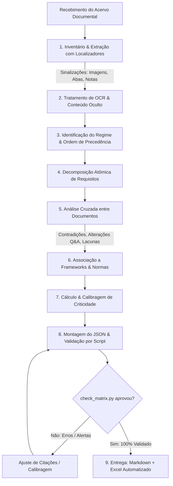

# Matriz Analítica de Concorrência (RFP)

> **Engenharia de requisitos, auditoria de riscos de proposta e matriz analítica rastreável de 23 colunas para processos de concorrência públicos e privados.**

[](https://www.python.org/downloads/)
[](https://docs.anthropic.com/)
[](https://openpyxl.readthedocs.io/)
[](#)
[](#)

O **RFP Matriz Analítica** é um sistema completo de auditoria e extração de requisitos para equipes de **Bid Management, Pré-venda, Arquitetura de Soluções, Jurídico e Pricing**. Atuando estritamente do lado do **proponente (fornecedor)**, ele processa todo o acervo documental de uma concorrência (RFPs, editais, termos de referência, anexos técnicos, minutas contratuais, apresentações, questionários e cadernos de perguntas e respostas / Q&A) e gera uma **matriz analítica auditável de 23 colunas**, em Markdown e Excel.

O sistema elimina o trabalho manual e o risco de surpresas em propostas comerciais complexas, detectando automaticamente **contradições entre documentos**, **lacunas críticas de precificação**, **armadilhas contratuais**, **critérios eliminatórios**, **prazos conflitantes**, **notas ocultas** e **páginas escaneadas**.

---

## 📑 Sumário

- [1. Visão Geral e Capacidades](#1-visão-geral-e-capacidades)
- [2. Persona vs. Skill: Duas Formas de Uso](#2-persona-vs-skill-duas-formas-de-uso)
- [3. Arquitetura da Matriz (23 Colunas)](#3-arquitetura-da-matriz-23-colunas)
- [4. Stack Tecnológico e Dependências](#4-stack-tecnológico-e-dependências)
- [5. Instalação e Pré-requisitos](#5-instalação-e-pré-requisitos)
- [6. Guia de Início Rápido (Getting Started)](#6-guia-de-início-rápido-getting-started)
  - [Fluxo 1: Skill Automatizada no Claude (Claude Code / Desktop / Claude.ai)](#fluxo-1-skill-automatizada-no-claude-claude-code--desktop--claudeai)
  - [Fluxo 2: Pipeline Híbrido via Terminal (Python CLI + Qualquer LLM)](#fluxo-2-pipeline-híbrido-via-terminal-python-cli--qualquer-llm)
  - [Fluxo 3: Persona Portátil (ChatGPT, Gemini, Copilot, Modelos Locais)](#fluxo-3-persona-portátil-chatgpt-gemini-copilot-modelos-locais)
- [7. Pipeline de Execução e Ciclo de Vida](#7-pipeline-de-execução-e-ciclo-de-vida)
- [8. Motor de Criticidade e Calibragem de Risco](#8-motor-de-criticidade-e-calibragem-de-risco)
- [9. Catálogo de Taxonomias e Frameworks](#9-catálogo-de-taxonomias-e-frameworks)
- [10. Referência dos Scripts CLI](#10-referência-dos-scripts-cli)
- [11. Formato de Troca JSON (`build_matrix.py`)](#11-formato-de-troca-json-build_matrixpy)
- [12. Kit de Testes Sintético e Validação Automatizada](#12-kit-de-testes-sintético-e-validação-automatizada)
- [13. Solução de Problemas e Armadilhas Comuns](#13-solução-de-problemas-e-armadilhas-comuns)
- [14. Estrutura do Repositório](#14-estrutura-do-repositório)
- [15. Contribuição e Extensão](#15-contribuição-e-extensão)

---

## 1. Visão Geral e Capacidades

O objetivo fundamental deste sistema é fornecer **evidência inquestionável** para decisões de *Go/No-Go*, balizamento de preços, elaboração de questionamentos no prazo de esclarecimento (Q&A) e confecção de propostas comerciais e técnicas à prova de desclassificação.

### Três Pilares Fundamentais

1. **Rastreabilidade Absoluta:** Cada linha possui citação literal exata entre aspas e localizador físico/lógico preciso (página física e impressa no PDF, parágrafo/cláusula no Word, slide e notas no PowerPoint, aba e coordenadas de célula no Excel).
2. **Ceticismo Investigativo:** O texto do cliente não é considerado coerente por padrão. Contradições entre anexos, ambiguidades redacionais e omissões intencionais ou acidentais são ativamente mineradas.
3. **Zero Alucinação:** Proibição estrita de artigos de lei inexistentes, controles de normas desatualizados, páginas estimadas ou deduções sem lastro factual nos documentos fornecidos.

### Principais Funcionalidades

- **Varredura Profunda de Formatos Oficiais:**
  - **PDF:** Extração de texto com diferenciação entre página física do leitor e página impressa no rodapé; detecção automática de páginas com pouco texto (prováveis documentos escaneados/assinados) e exportação em PNG para leitura visual/OCR.
  - **Word (`.docx`):** Mapeamento hierárquico por seções, leitura de tabelas, identificação de marcas de revisão não aceitas (*track changes*), texto oculto e comentários.
  - **PowerPoint (`.pptx`):** Extração de texto de formas e tabelas, sinalização de slides ocultos e leitura mandatória de **notas do apresentador** (onde clientes comumente ocultam regras e ampliações de escopo).
  - **Excel (`.xlsx`, `.xlsm`):** Leitura de valores calculados vs. fórmulas, identificação de **abas ocultas e muito ocultas (*veryHidden*)**, linhas/colunas ocultas e comentários de célula.
- **Rastreamento de Vigência e Adendos:** Quando uma rodada de Q&A ou adendo altera um item anterior, o sistema vincula os identificadores, marca o item original como `Alterado` ou `Substituído` e mantém a auditoria histórica.
- **Prevenção de Falsos Positivos de Risco (Calibragem):** Regras matemáticas para impedir inflação de criticidade, travando itens `Duplicado` ou informativos com `—` e exigindo citação literal expressa para qualquer probabilidade 4 ou 5.
- **Auditoria de Conformidade (Linter Integrado):** O validador confere a integridade estrutural das 23 colunas, a fórmula matemática da criticidade, unicidade de IDs e a presença de controles obsoletos.

---

## 2. Persona vs. Skill: Duas Formas de Uso

O projeto está disponível em dois formatos complementares:

| Característica | Persona (`persona-analista-rfp.md`) | Skill (`skills/rfp-matriz-analitica/`) |
|---|---|---|
| **O que é** | Prompt de sistema monolítico em Markdown (~30k caracteres) | Pacote de agente com instruções modulares, scripts Python e validadores |
| **Ambiente de execução** | Qualquer LLM (ChatGPT, Claude.ai sem código, Gemini, Copilot, Ollama, LM Studio) | Claude Code, Claude Desktop com Code Execution, ou ambiente CLI Python |
| **Extração de arquivos** | Depende do leitor de arquivos nativo do LLM | Scripts Python dedicados com extração de abas ocultas, notas e geração de PNG para OCR |
| **Montagem da tabela** | Gerada manualmente pelo LLM em blocos de até 30 linhas com `continuar` | Montada automaticamente via script `build_matrix.py` a partir de um JSON estruturado |
| **Validação de integridade** | Manual pelo operador | Automatizada via `check_matrix.py` (colunas, IDs, aritmética e citações) |
| **Exportação Excel** | Manual (copiar/colar da conversa) | Automática com formatação condicional, filtros e abas analíticas (`export_xlsx.py`) |
| **Nível de maturidade** | Portátil e universal | Completa, calibrada e testada em 4 iterações formais |

---

## 3. Arquitetura da Matriz (23 Colunas)

Cada linha da matriz analítica representa um **item atômico** de informação. Todas as colunas são obrigatórias na estrutura tabular (células não aplicáveis recebem o caractere de traço `—`).

| # | Nome da Coluna | Descrição Técnica | Exemplo |
|---|---|---|---|
| **1** | `ID` | Código identificador único: `Dnn-nnn` (D + documento + sequência). | `D01-014` |
| **2** | `Documento` | Nome exato do arquivo analisado. | `RFP-2026-017_Servicos_SOC_IAM.pdf` |
| **3** | `Versão/Data` | Versão formal ou data identificada no documento (ou `não informada`). | `v1.0 — 15/10/2026` |
| **4** | `Seção/Cláusula` | Número e título formal da seção ou cláusula. | `§ 4.2 Critérios de Habilitação Técnica` |
| **5** | `Localizador` | Âncora de localização no documento físico/lógico. | `p. 6 (impressa: 5) (OCR)` |
| **6** | `Evidência` | Citação textual **literal**, entre aspas, no idioma original. Supressões indicadas por `[...]`. Em contradições: `A: "..." · B: "..."`. | `"A contratada deverá manter equipe SOC 24x7 no Brasil."` |
| **7** | `Tipo de item` | Classificação funcional do item (21 tipos padronizados). | `Critério eliminatório / de habilitação` |
| **8** | `Domínio` | Área temática de negócio/técnica (17 domínios padronizados). | `Segurança da Informação/Cyber` |
| **9** | `Descrição analítica` | Síntese do significado prático para o proponente e explicitação de premissas/raciocínio. | `Exigência de operação local física impede subcontratação offshore.` |
| **10** | `Obrigatoriedade` | Nível de vinculação: `Mandatório`, `Desejável` ou `Informativo`. | `Mandatório` |
| **11** | `Natureza da evidência` | Origem da constatação: `Explícita` (escrita) ou `Inferida` (deduzida por lógica). | `Explícita` |
| **12** | `Severidade` | Impacto potencial isolado: `1 · Insignificante` a `5 · Severa`. | `5 · Severa` |
| **13** | `Probabilidade` | Chance de ocorrência se não tratado: `1 · Remota` a `5 · Quase certa`. Exige justificativa com evidência se 4 ou 5. | `5 · Quase certa` |
| **14** | `Criticidade` | Produto `Severidade × Probabilidade` com classificação (`Baixa`, `Média`, `Alta`, `Crítica`). Regra S5 sempre ≥ Alta. | `25 · Crítica` |
| **15** | `Impacto para o proponente` | Consequência direta em preço, prazo, margem, equipe, penalidade ou viabilidade. | `Inabilitação imediata da proposta se o SOC for remoto/fora do país.` |
| **16** | `Framework/Referência` | Norma, padrão ou legislação de mercado associada (versão exata). | `ISO/IEC 27001:2022` |
| **17** | `Controle/Cláusula` | Identificador exato do controle/artigo ou tema com `(identificador a confirmar)`. | `A.5.15 Controle de acesso` |
| **18** | `Tipo de associação` | Vínculo com a norma: `Direta`, `Correlata`, `Boa prática` ou `Não aplicável`. | `Direta` |
| **19** | `IDs relacionados` | Relações cruzadas com outros itens (`{chave}` resolvida para `Dnn-nnn`). | `D02-003, D04-012` |
| **20** | `Status de vigência` | Vigência normativa: `Vigente`, `Alterado`, `Substituído`, `Duplicado` ou `Em esclarecimento`. | `Vigente` |
| **21** | `Ação recomendada` | Próximo passo do proponente (8 ações padronizadas). | `Atender` |
| **22** | `Pergunta de esclarecimento` | Texto pronto para submissão no pedido de esclarecimentos / Q&A oficial do processo. | `"Favor confirmar se a exigência de equipe no Brasil aplica-se ao N1 e N2."` |
| **23** | `Responsável interno sugerido` | Papel interno na organização do proponente para liderar a tratativa. | `Segurança/Cyber` |

---

## 4. Stack Tecnológico e Dependências

O núcleo técnico do projeto utiliza Python nativo moderno com quatro bibliotecas consagradas de engenharia documental:

- **Linguagem:** Python 3.9+ (compatível com 3.10, 3.11, 3.12 e 3.13)
- **Manipulação de PDF:** [`pdfplumber`](https://github.com/jsvine/pdfplumber) — Análise espacial de layout, detecção de cabeçalhos/rodapés repetidos, extração de texto estruturado e renderização de páginas em imagem raster para OCR.
- **Manipulação de Word:** [`python-docx`](https://python-docx.readthedocs.io/) e parser direto de XML compactado (`zipfile`) para inspeção de marcas de revisão (*track changes*), texto oculto e comentários.
- **Manipulação de Slides:** [`python-pptx`](https://python-pptx.readthedocs.io/) — Navegação em hierarquias de formas, tabelas, slides ocultos e blocos de anotações do apresentador (*notes slides*).
- **Planilhas e Exportação:** [`openpyxl`](https://openpyxl.readthedocs.io/) — Inspeção de abas ocultas e `veryHidden`, fórmulas não avaliadas, e geração de planilhas formatadas com paleta de cores corporativa, painel congelado e filtros automáticos.

---

## 5. Instalação e Pré-requisitos

### Ambiente Python Local

Clone o repositório ou navegue até o diretório do projeto:

```bash
# Navegar até a pasta do projeto
cd rfp-matriz-analitica

# Criar um ambiente virtual (recomendado)
python -m venv .venv

# Ativar no Linux / macOS
source .venv/bin/activate

# Ativar no Windows (PowerShell)
.venv\Scripts\Activate.ps1

# Instalar as dependências de processamento documental
pip install pdfplumber python-docx python-pptx openpyxl
```

---

## 6. Guia de Início Rápido (Getting Started)

### Fluxo 1: Skill Automatizada no Claude (Claude Code / Desktop / Claude.ai)

A skill empacotada em `skills/rfp-matriz-analitica.skill` (ou a pasta-fonte `skills/rfp-matriz-analitica/`) é nativa do ecossistema Claude.

#### Instalação no Claude Code (CLI)
Copie ou descompacte o pacote na pasta de skills do seu usuário ou projeto:

```bash
# Instalação global (disponível para todos os seus projetos)
mkdir -p ~/.claude/skills
unzip -o skills/rfp-matriz-analitica.skill -d ~/.claude/skills/

# Ou instalação local apenas no repositório atual
mkdir -p .claude/skills
unzip -o skills/rfp-matriz-analitica.skill -d .claude/skills/
```

#### Instalação no Claude Desktop / Claude.ai
1. Abra as **Configurações** (Settings) → **Capacidades** (Capabilities) → **Skills**.
2. Clique em **Upload Skill** e selecione o arquivo `skills/rfp-matriz-analitica.skill`.
3. Garanta que o recurso de **Execução de Código (Code Execution / Analysis)** esteja ativado na ferramenta.

#### Executando a Análise
Com os arquivos anexados ou no diretório, envie a solicitação:

```text
Analise os documentos da concorrência anexados.
Comece pelo inventário e gere a matriz em arquivo Markdown e Excel.
```

---

### Fluxo 2: Pipeline Híbrido via Terminal (Python CLI + Qualquer LLM)

Este é o fluxo recomendado para máxima precisão técnica, permitindo usar qualquer modelo de IA (incluindo Claude, GPT-4o, Gemini 1.5 Pro ou modelos locais via Ollama) com a garantia de que as citações e contas serão validadas por código.

```
┌─────────────────────────────────┐
│ 1. Documentos Originais         │ (PDF, Word, PPT, Excel)
└───────────────┬─────────────────┘
                │
                ▼
┌─────────────────────────────────┐
│ 2. python extract_documents.py  │ ➔ Extrai texto com localizadores [p. X],
└───────────────┬─────────────────┘   detecta abas ocultas, notas e gera PNGs
                │
                ▼
┌─────────────────────────────────┐
│ 3. LLM (Claude / GPT / Gemini)  │ ➔ Lê o inventário + textos e gera
└───────────────┬─────────────────┘   arquivo itens.json estruturado
                │
                ▼
┌─────────────────────────────────┐
│ 4. python build_matrix.py       │ ➔ Monta a matriz, calcula criticidade,
└───────────────┬─────────────────┘   confere citações literais e roda linter
                │
                ▼
┌─────────────────────────────────┐
│ 5. Arquivos Finais Entregues    │ ➔ Processo_Matriz_Analitica.md
└─────────────────────────────────┘   Processo_Matriz_Analitica.xlsx
```

#### Passo a Passo:

#### 1. Extrair os documentos
Passe os arquivos **na ordem de precedência padrão**:
*Edital/RFP principal → Anexos técnicos → Anexos comerciais/Minuta → Apresentações → Q&A/Adendos*

```bash
python skills/rfp-matriz-analitica/scripts/extract_documents.py \
  --out trabalho/extracao \
  kit-de-testes/documentos/RFP-2026-017_Servicos_SOC_IAM.pdf \
  kit-de-testes/documentos/Anexo_I_Especificacao_Tecnica.docx \
  kit-de-testes/documentos/Apresentacao_Ambiente_Atual.pptx \
  kit-de-testes/documentos/QA_Rodada1_e_Questionario.xlsx
```
*Saída gerada:* `trabalho/extracao/inventario.md`, arquivos `D01_*.md` a `D04_*.md` e imagens rasterizadas em `trabalho/extracao/imagens/`.

#### 2. Gerar os Itens com o LLM
Envie os arquivos de texto extraídos e as regras ao LLM, solicitando a saída no formato JSON de itens (detalhado na [Seção 11](#11-formato-de-troca-json-build_matrixpy)). Salve o resultado como `trabalho/itens.json`.

#### 3. Montar, Validar e Exportar para Excel
Execute o `build_matrix.py` apontando para a pasta de extração para que as citações literais sejam conferidas contra os arquivos originais:

```bash
python skills/rfp-matriz-analitica/scripts/build_matrix.py trabalho/itens.json \
  --out RFP-2026-017_Matriz_Analitica.md \
  --extracao trabalho/extracao \
  --xlsx
```

#### 4. Validar Matriz Manualmente (Opcional)
Se quiser rodar o linter de auditoria isoladamente:

```bash
python skills/rfp-matriz-analitica/scripts/check_matrix.py RFP-2026-017_Matriz_Analitica.md
```

---

### Fluxo 3: Persona Portátil (ChatGPT, Gemini, Copilot, Modelos Locais)

Quando você estiver utilizando uma interface de chat puramente conversacional que não possui ambiente de execução Python:

1. Abra uma nova sessão no seu assistente de IA.
2. Copie a totalidade do conteúdo de [`persona-analista-rfp.md`](file:///c:/Users/thiag/OneDrive/Documents/Prj_Antigravity/rfp-matriz-analitica/persona-analista-rfp.md) e cole no campo de **Instruções Personalizadas (System Prompt)** ou como **primeira mensagem**.
3. Anexe os documentos do processo de concorrência.
4. Envie o comando padronizado:

```markdown
# Solicitação de análise

## Processo
- Cliente: [Nome da Organização Contratante]
- Identificação do processo: [ex.: RFP nº 2026-017]
- Objeto resumido: [ex.: Serviços Gerenciados de SOC e Gestão de Identidades]
- Valor estimado do contrato: [Valor em R$ ou "não informado"]

## Documentos anexados
| # | Arquivo | Tipo | Versão/Data |
|---|---|---|---|
| 1 | RFP_Principal.pdf | RFP | v1.0 |
| 2 | Anexo_I_Tecnico.docx | Anexo técnico | v1.0 |
| 3 | QA_Rodada_1.xlsx | Q&A e esclarecimentos | 15/10/2026 |

## Instruções desta análise
- Ordem de processamento: padrão
- Limite de linhas por resposta: 30

## Comando
Analise os documentos acima. Comece pelo inventário.
```

5. O assistente emitirá as respostas em lotes de até 30 linhas encabeçadas por `▶ PARTE n` e finalizadas com blocos de status:
   - Se o rodapé exibir `⏸ STATUS: ANÁLISE EM ANDAMENTO`, envie apenas `continuar`.
   - Se exibir `✅ STATUS: ANÁLISE CONCLUÍDA`, o processo terminou. Copie as tabelas para a sua planilha de trabalho.

---

## 7. Pipeline de Execução e Ciclo de Vida



### Etapas Detalhadas:

1. **Inventário & Extração (`extract_documents.py`):** Atribui os códigos imutáveis `D01`, `D02`, etc., gera marcadores de página e sinaliza elementos de alto risco não visíveis no texto corrido.
2. **Tratamento de Páginas Escaneadas e OCR:** Páginas com menos de 150 caracteres são rasterizadas em PNG (`imagens/`). O analista/agente lê a imagem e marca o localizador com a tag `(OCR)`. Transcrições podem ser salvas em `Dnn_pN_ocr.md` para verificação automática de citações.
3. **Regime e Precedência:** Identifica se o certame é privado ou público (ex.: vedação estrita de associar a Lei 14.133/2021 em concorrências privadas). Verifica a cláusula de precedência; caso inexistente, registra uma `Lacuna`.
4. **Decomposição Atômica:** Requisitos compostos ("o sistema deve fornecer X e suportar Y") são fatiados em linhas independentes. Textos meramente institucionais ("fundado em 1980...") são descartados.
5. **Análise Cruzada e Vigência:** Cruzamento temporal entre o RFP original e os esclarecimentos/adendos. Se o Q&A alterou um SLA, o item do RFP recebe vigência `Alterado` e aponta para o ID do Q&A.
6. **Mapeamento de Frameworks:** Vinculação precisa a catálogos vigentes (ISO 27001:2022, LGPD, CIS Controls v8, ITIL 4). Controles obsoletos (como ISO versão 2013) disparam erro no validador.
7. **Montagem e Exportação (`build_matrix.py` & `export_xlsx.py`):** Consolidação do arquivo Markdown e planilha XLSX profissional com coloração semafórica nas células de criticidade.

---

## 8. Motor de Criticidade e Calibragem de Risco

A criticidade reflete o impacto potencial para o proponente e a probabilidade de ocorrência **caso o proponente não adote ação corretiva**.

$$\text{Pontuação de Criticidade} = \text{Severidade (1 a 5)} \times \text{Probabilidade (1 a 5)}$$

### Escalas de Avaliação

#### Severidade (Impacto Potencial)
- **1 · Insignificante:** Sem reflexo apreciável em preço, prazo, escopo ou obrigações.
- **2 · Menor:** Efeito pontual, perfeitamente absorvível na margem técnica ordinária.
- **3 · Moderada:** Requer premissa formal, pequeno ajuste de equipe/custo ou exposição financeira estimada entre 1% e 5% do contrato.
- **4 · Maior:** Impacto severo em margem, cronograma ou pontuação técnica; exposição estimada entre 5% e 25% do valor do contrato.
- **5 · Severa:** Desclassificação/inabilitação imediata, responsabilidade civil ilimitada, ou inviabilidade técnica de precificação (> 25% do contrato).

#### Probabilidade (Incerteza e Certeza Documental)
- **1 · Remota:** Cenário puramente hipotético ou improvável.
- **2 · Improvável:** O documento dá indícios de baixa cobrança ou baixa incidência.
- **3 · Possível (Padrão):** Cenário plausível; o texto não oferece elementos para mais ou para menos. É o valor padrão para ambiguidades, lacunas e contradições.
- **4 · Provável:** Há evidência específica no acervo documental de que a situação se concretizará (ex.: multa automática, recusa formal do cliente no Q&A).
- **5 · Quase certa:** O texto prevê expressamente o desfecho mandatório (ex.: item eliminatório explícito em caso de não entrega de certidão).

### Matriz de Classificação

| Pontuação | Classificação | Cor na Planilha Excel | Ação Típica |
|---|---|---|---|
| **16 – 25** | **Crítica** | Vermelho (`#F4B6B6`) | Avaliar Go/No-Go, mitigação urgente ou ressalva mandatória |
| **10 – 15** | **Alta** | Laranja (`#F8D7A8`) | Esclarecer no Q&A, ajustar preço de risco ou exigir aprovação de diretoria |
| **5 – 9** | **Média** | Amarelo (`#FFF2B3`) | Incluir premissa explícita na proposta técnica/comercial |
| **1 – 4** | **Baixa** | Verde (`#D5ECD4`) | Atendimento ordinário de engenharia de proposta |

### Regras Mandatórias de Calibragem

1. **A Regra de Severidade 5:** Qualquer item com Severidade 5 **nunca pode ser classificado como Baixa ou Média**, mesmo que a probabilidade seja 1 ou 2 ($5 \times 1 = 5$ ou $5 \times 2 = 10$). O sistema classifica automaticamente como **Alta** ou **Crítica**.
2. **Exigência de Citação Literal para Probabilidade 4 ou 5:** Para evitar inflação arbitrária, qualquer item com Probabilidade 4 ou 5 deve conter na Descrição Analítica o formato obrigatório:
   `Probabilidade 5: <motivo objetivo> — "<trecho citado entre aspas>"` (ou comprovação expressa de recusa do cliente). Sem isso, o linter acusa advertência.
3. **Itens Não Pontuados (`—`):** As linhas de `Registro de cobertura`, `Oportunidade / diferencial` e itens com vigência `Duplicado` não recebem severidade nem probabilidade (recebem `—`).
4. **Teto de Distribuição Saudável:**
   - Itens **Críticos** não devem ultrapassar ~25% do total da matriz.
   - Itens **Altos** não devem ultrapassar ~40% do total da matriz.
   Se os limites forem ultrapassados, o validador emite aviso para revisão das notas de severidade 4 infladas.

---

## 9. Catálogo de Taxonomias e Frameworks

O sistema emprega vocabulário estritamente padronizado em todas as análises para garantir conformidade e permitir filtros determinísticos no Excel e no BI.

### Tipos de Item (21 Categorias)
- `Requisito funcional / de serviço`
- `Requisito não funcional`
- `Critério eliminatório / de habilitação`
- `Critério de avaliação / pontuação`
- `Instrução de resposta`
- `Prazo / marco`
- `SLA / KPI`
- `Penalidade / multa / glosa`
- `Obrigação contratual`
- `Entregável`
- `Premissa do cliente`
- `Restrição`
- `Responsabilidade / dependência do cliente`
- `Dado de dimensionamento`
- `Contradição`
- `Ambiguidade`
- `Lacuna`
- `Risco para o proponente`
- `Requisito implícito`
- `Oportunidade / diferencial`
- `Registro de cobertura`

### Domínios de Negócio (17 Domínios)
`Técnico/Arquitetura` · `Segurança da Informação/Cyber` · `Privacidade/Proteção de Dados` · `Infraestrutura/Cloud` · `Dados/Analytics` · `Operação/Serviços` · `Gestão de Projetos` · `Transição/Implantação` · `Comercial/Preço` · `Financeiro` · `Jurídico/Contratual` · `Regulatório/Compliance` · `Pessoas/Equipe` · `Qualidade` · `Continuidade` · `ESG` · `Administrativo do processo`.

### Frameworks de Referência Auditáveis
- **Segurança da Informação:** ISO/IEC 27001:2022 (Anexo A contendo Controles A.5 a A.8), ISO/IEC 27002:2022, NIST CSF 2.0, CIS Controls v8. *(Nota: Controles no padrão ISO antigo 2013 A.9 a A.18 são bloqueados pelo linter).*
- **Privacidade e Proteção de Dados:** LGPD (Lei Federal 13.709/2018), ISO/IEC 27701.
- **Serviços e Governança de TI:** ITIL 4, ISO/IEC 20000-1, COBIT 2019.
- **Gestão de Projetos e Propostas:** PMBOK Guide (7ª edição), Scrum Guide, APMP Body of Knowledge.
- **Arquitetura & Nuvem:** TOGAF, AWS/Azure/GCP Well-Architected Frameworks.
- **Continuidade & Riscos:** ISO 22301 (Continuidade de Negócios), ISO 31000 (Gestão de Riscos).
- **Legislação e Regime:** Identificado estritamente pelas evidências dos autos (ex.: Código Civil para contratações privadas; Lei 14.133/2021 exclusiva para certames públicos federais/estaduais/municipais).

---

## 10. Referência dos Scripts CLI

Todos os scripts estão localizados em `skills/rfp-matriz-analitica/scripts/`.

### 1. `extract_documents.py`
Extrai o acervo documental preservando localizadores e identificando elementos ocultos.

```bash
python skills/rfp-matriz-analitica/scripts/extract_documents.py \
  --out <pasta_destino> \
  [--start 1] \
  <arquivo1> [<arquivo2> ...]
```
- `--out`: Diretório onde serão gravados os arquivos `.md` individuais, o `inventario.md` e a pasta `imagens/`.
- `--start`: Índice numérico do primeiro documento (padrão: `1`, gerando `D01`). Útil em análises incrementais (ex.: `--start 5` para processar um adendo recebido posteriormente como `D05`).

### 2. `build_matrix.py`
Processa o arquivo JSON com os itens minerados, calcula criticidades, verifica citações literais contra os textos originais, roda o validador e gera os arquivos finais.

```bash
python skills/rfp-matriz-analitica/scripts/build_matrix.py \
  <arquivo_itens.json> \
  --out <matriz_final.md> \
  [--extracao <pasta_de_extracao>] \
  [--xlsx]
```
- `<arquivo_itens.json>`: Especificação estruturada de documentos e itens.
- `--out`: Caminho do arquivo Markdown da matriz consolidada.
- `--extracao`: Caminho da pasta gerada pelo `extract_documents.py`. Quando informado, confere se cada citação literal entre aspas consta no texto extraído.
- `--xlsx`: Dispara automaticamente o script `export_xlsx.py`, criando a planilha correspondente.

### 3. `check_matrix.py`
Linter estrutural e metodológico que valida a conformidade de uma matriz Markdown já montada.

```bash
python skills/rfp-matriz-analitica/scripts/check_matrix.py \
  <matriz_final.md> \
  [--max-critica 0.25] \
  [--max-alta 0.40]
```
- `--max-critica`: Limite percentual de itens Críticos antes de disparar aviso de calibração (padrão: `0.25` / 25%).
- `--max-alta`: Limite percentual de itens Altos antes de disparar aviso (padrão: `0.40` / 40%).
- **Retorno:** Código `0` para aprovado (ou apenas avisos informativos); Código `1` para erros impeditivos (colunas faltando, IDs duplicados, cálculo matemático errado).

### 4. `export_xlsx.py`
Converte a matriz Markdown em uma pasta de trabalho Excel (`.xlsx`) estilizada.

```bash
python skills/rfp-matriz-analitica/scripts/export_xlsx.py \
  <matriz_final.md> \
  [<planilha_saida.xlsx>]
```
- Cria 3 abas estruturadas:
  1. **Matriz:** Tabela completa com formatação condicional, autofiltro ativo, largura ajustada por coluna e cabeçalho congelado.
  2. **Documentos:** Tabela com o inventário dos documentos processados.
  3. **Resumo:** Painel com estatísticas de contagem por documento, criticidade, tipo e ação recomendada, além do status de pendências de cobertura.

---

## 11. Formato de Troca JSON (`build_matrix.py`)

Ao orquestrar o sistema por agentes ou automações, a IA ou o usuário emite um arquivo JSON intermediário com a seguinte estrutura:

```json
{
  "processo": "RFP nº 2026-017 — Banco Horizonte Fictício S.A.",
  "documentos": [
    {
      "codigo": "D01",
      "arquivo": "RFP-2026-017_Servicos_SOC_IAM.pdf",
      "tipo": "RFP",
      "versao": "v1.0 — 15/10/2026",
      "situacao": "processado"
    },
    {
      "codigo": "D02",
      "arquivo": "Anexo_I_Especificacao_Tecnica.docx",
      "tipo": "Anexo técnico",
      "versao": "v1.0 — 15/10/2026",
      "situacao": "processado"
    }
  ],
  "itens": [
    {
      "chave": "d01_regime",
      "doc": "D01",
      "secao": "§ 1. Contexto Geral",
      "localizador": "p. 2 (impressa: 1)",
      "evidencia": "\"sociedade anônima de capital fechado, regida pelo direito privado\"",
      "tipo": "Registro de cobertura",
      "dominio": "Jurídico/Contratual",
      "descricao": "Regime privado identificado. Inaplicável a Lei 14.133/2021.",
      "obrigatoriedade": "—",
      "natureza": "Explícita",
      "vigencia": "Vigente",
      "acao": "Nenhuma (informativo)",
      "responsavel": "Jurídico"
    },
    {
      "chave": "d01_transicao",
      "doc": "D01",
      "secao": "§ 3. Cronograma",
      "localizador": "p. 4 (impressa: 3)",
      "evidencia": "\"o período de transição/handover não poderá exceder 30 (trinta) dias\"",
      "tipo": "Prazo / marco",
      "dominio": "Transição/Implantação",
      "descricao": "Prazo de transição de 30 dias contraria os 60 dias do Anexo I ({d02_transicao_60d}).",
      "obrigatoriedade": "Mandatório",
      "natureza": "Explícita",
      "s": 4,
      "p": 3,
      "impacto": "Risco de penalidade se a transição exigir 60 dias.",
      "framework": "ITIL 4",
      "controle": "Transição de Serviço",
      "associacao": "Boa prática",
      "relacionados": ["{d02_transicao_60d}"],
      "vigencia": "Vigente",
      "acao": "Esclarecer no Q&A",
      "pergunta": "Favor esclarecer se o prazo de transição é de 30 dias (conforme RFP) ou 60 dias (conforme Anexo I).",
      "responsavel": "Delivery/Operação"
    }
  ],
  "status": {
    "final": true
  }
}
```

> **Dica de Resolução de Dependências:** O motor substitui automaticamente qualquer tag no padrão `{chave}` (como `{d02_transicao_60d}`) pelo ID final correspondente (`D02-004`), dispensando o controle manual de números de linha entre documentos cruzados.

---

## 12. Kit de Testes Sintético e Validação Automatizada

O repositório inclui um caso de teste completo e propositalmente viciado sob o diretório [`kit-de-testes/`](file:///c:/Users/thiag/OneDrive/Documents/Prj_Antigravity/rfp-matriz-analitica/kit-de-testes):

- **Cenário:** Contratação fictícia de serviços gerenciados de SOC e IAM pelo *Banco Horizonte Fictício S.A.* (RFP nº 2026-017).
- **Acervo:** 4 arquivos reais em `kit-de-testes/documentos/` (PDF com páginas impressas divergentes e página digitalizada, Word com marcas de revisão, PowerPoint com notas e Excel com abas ocultas).
- **Gabarito Oficial:** [`kit-de-testes/avaliacao/Gabarito.md`](file:///c:/Users/thiag/OneDrive/Documents/Prj_Antigravity/rfp-matriz-analitica/kit-de-testes/avaliacao/Gabarito.md) contendo **68 itens esperados**, dos quais **31 são essenciais (★)** e **13 são armadilhas intencionais**.

### As 13 Armadilhas do Kit de Testes

| # | Código | Armadilha Plantada no Documento | Comportamento Esperado do Sistema |
|---|---|---|---|
| 1 | `A01` | **Página Escaneada:** Página 6 do PDF (Anexo III) é uma imagem sem OCR. | Sinalizar necessidade de OCR, renderizar PNG e extrair a exigência sob pena de inabilitação. |
| 2 | `A02` | **Residência de Dados Conflitante:** Anexo III exige dados 100% no Brasil; Anexo I permite nuvem em qualquer região. | Apontar Contradição com IDs relacionados e pergunta de esclarecimento. |
| 3 | `A03` | **Ausência de Cláusula de Precedência:** Nenhum documento estipula qual prevalece. | Registrar Lacuna sem assumir tacitamente qual documento manda. |
| 4 | `A04` | **Divergência de Prazos de Transição:** RFP exige 30 dias; Anexo I especifica 60 dias. | Registrar Contradição com cruzamento de localizadores. |
| 5 | `A05` | **Divergência de Retenção de Logs:** Edital pede 12 meses; Anexo I pede 5 anos. | Registrar Contradição / Ambiguidade de dimensionamento de storage. |
| 6 | `A06` | **Inconsistência Aritmética de Pontuação:** A soma dos pesos dos critérios técnicos totaliza 65 pontos, mas o edital declara pontuação máxima de 60. | Registrar Contradição nos critérios de julgamento. |
| 7 | `A07` | **Divergência de Base de Usuários:** Edital menciona 4.500 colaboradores; slide menciona 6.200. | Registrar Contradição em dado de dimensionamento. |
| 8 | `A08` | **Escopo Oculto em Notas de Slide:** O slide 5 da apresentação traz nas anotações do apresentador a inclusão de 900 usuários de subsidiárias. | Extrair e analisar o texto das notas do apresentador. |
| 9 | `A09` | **Regra Oculta em Planilha:** Aba oculta "Pesos" no Excel aplica desconto punitivo de 2 pontos por não conformidade. | Extrair a aba oculta e analisar a regra de penalização técnica. |
| 10 | `A10` | **Anexo IV Citado e Não Fornecido:** O edital exige preenchimento da planilha do Anexo IV, mas o arquivo não acompanha o pacote. | Registrar Lacuna com criticidade e pergunta no Q&A. |
| 11 | `A11` | **Matriz de Criticidade Não Disponibilizada:** O edital refere-se à matriz interna de criticidade do cliente sem anexá-la. | Registrar Lacuna com impacto no cálculo de multas de SLA. |
| 12 | `A12` | **Prorrogação de Prazo no Q&A:** A resposta da Pergunta 12 do Q&A prorroga a data limite de entrega de 20/11 para 27/11. | Alterar o status do item original do RFP para `Alterado` e registrar o novo marco. |
| 13 | `A13` | **Tentação de Citar a Lei 14.133/2021:** O edital tem estrutura similar à de compras públicas, mas é de uma S.A. privada. | Reconhecer o regime estritamente privado e **não** citar leis de licitação pública. |

### Avaliador Automatizado de Benchmarks (`grade_matrix.py`)

O repositório disponibiliza um avaliador que realiza **38 verificações automáticas** (22 de integridade estrutural e rastreabilidade e 16 de cobertura de conteúdo crítico):

```bash
python skills/rfp-matriz-analitica/evals/grade_matrix.py \
  --eval-id 1 \
  --matrix RFP-2026-017_Matriz_Analitica.md \
  --out grading_results.json
```

**Resultados Históricos de Desenvolvimento (3 Iterações):**
- **Sem a Skill (LLM puro):** Atinge em média ~55% dos checks (alucina artigos de lei, omite notas ocultas e quebra o formato de colunas).
- **Com a Skill RFP Matriz Analítica:** **100% de aprovação nos 38 critérios de avaliação**, índice de Críticas estabilizado em ~11% e Altas em ~30%, comprovando total imunidade a falsos positivos.

---

## 13. Solução de Problemas e Armadilhas Comuns

| Sintoma / Mensagem | Causa Raiz Provável | Como Resolver |
|---|---|---|
| `ModuleNotFoundError: No module named 'pdfplumber'` | Dependência Python não instalada no ambiente | Execute: `pip install pdfplumber python-docx python-pptx openpyxl` |
| `AVISO: muitas Críticas (mais de 25%)` | Efeito em cadeia não tratado; severidade herdada de itens vizinhos | Revise a severidade item a item. Registre um **único item de Risco para o proponente** para expressar a soma dos fatores e reduza os itens isolados. |
| `AVISO: muitas Altas (mais de 40%)` | Uso indiscriminado de Severidade 4 ($4 \times 3 = 12 \rightarrow \text{Alta}$) | Reserve Severidade 4 apenas para itens que causem desvios substanciais de margem/escopo. Itens de esclarecimento rotineiro ou premissas simples devem ser Severidade 3. |
| `AVISO: Lacuna/Contradição com Probabilidade 4/5 sem evidência` | Falta de citação literal da recusa do cliente | Adicione a citação entre aspas no formato: `Probabilidade 5: <motivo> — "<trecho citado>"` ou documente a recusa expressa. |
| `Citação não encontrada no texto extraído` | O LLM parafraseou a evidência ou houve erro de digitação | A coluna *Evidência* deve ser 100% copiada e colada do texto extraído. Se for de imagem OCR, salve a transcrição em `extracao/Dnn_pN_ocr.md`. |
| `ERRO: Cabeçalho difere das 23 colunas esperadas` | Colunas renomeadas, fundidas ou omitidas | Verifique se as 23 colunas estão na ordem exata definida na [Seção 3](#3-arquitetura-da-matriz-23-colunas). |
| `Página registrada como "requer OCR"` | PDF com imagem digitalizada sem camada de texto | Abra a imagem correspondente gerada em `extracao/imagens/Dnn_pX.png`, transcreva os requisitos e adicione a marcação `(OCR)` no localizador. |
| `A skill não é acionada automaticamente no Claude` | Prompt vago que não menciona edital/RFP | Diga explicitamente: *"Use a skill rfp-matriz-analitica para analisar os documentos anexados."* |

---

## 14. Estrutura do Repositório

```
rfp-matriz-analitica/
├── README.md                                    # Esta documentação completa do projeto
├── HELP.md                                      # Guia operacional de referência rápida em português
├── persona-analista-rfp.md                      # Persona completa monolítica para LLMs universais
│
├── skills/
│   ├── rfp-matriz-analitica.skill               # Pacote zip da skill pronto para importação no Claude
│   ├── rfp-matriz-analitica/                    # Código-fonte da skill do Claude
│   │   ├── SKILL.md                             # Instruções e ciclo de vida do agente
│   │   ├── scripts/                             # Utilitários de execução Python
│   │   │   ├── extract_documents.py             # Extrator multi-formato com localizadores e OCR flags
│   │   │   ├── build_matrix.py                  # Compilador JSON -> Markdown e orquestrador
│   │   │   ├── check_matrix.py                  # Linter de validação estrutural e aritmética
│   │   │   └── export_xlsx.py                   # Conversor Markdown -> Planilha Excel formatada
│   │   ├── references/                          # Bases de conhecimento modulares
│   │   │   ├── criticidade.md                   # Diretrizes do motor de severidade e probabilidade
│   │   │   ├── formato-saida.md                 # Especificação das 23 colunas e protocolo de status
│   │   │   ├── frameworks.md                    # Catálogo de normas auditáveis (ISO, NIST, LGPD, etc.)
│   │   │   ├── modelos-de-prompt.md             # Modelos de solicitação completa, incremental e Q&A
│   │   │   ├── rastreabilidade.md               # Padrões de localizadores por tipo de arquivo
│   │   │   └── taxonomias.md                    # Vocabulário fechado de tipos, domínios e ações
│   │   └── evals/                               # Conjunto de testes e benchmarks
│   │       ├── evals.json                       # 3 casos de teste e 38 asserções de validação
│   │       └── grade_matrix.py                  # Script de correção automática de benchmarks
│   └── rfp-matriz-analitica-workspace/          # Histórico de desenvolvimento, iterações e relatórios
│
└── kit-de-testes/                               # Caso de teste sintético completo
    ├── LEIA-ME.md                               # Manual de instruções do kit de testes
    ├── documentos/                              # Acervo fictício com 13 problemas plantados
    │   ├── RFP-2026-017_Servicos_SOC_IAM.pdf    # PDF com página digitalizada e páginas divergentes
    │   ├── Anexo_I_Especificacao_Tecnica.docx   # Word com comentários e marcas de revisão
    │   ├── Apresentacao_Ambiente_Atual.pptx     # Apresentação com notas do apresentador ocultas
    │   └── QA_Rodada1_e_Questionario.xlsx       # Excel com aba oculta "Pesos" e prorrogações
    └── avaliacao/                               # Gabaritos e instrumentos de mensuração
        ├── Gabarito.md                          # 68 itens esperados e mapeamento das 13 armadilhas
        ├── Planilha_de_Avaliacao.xlsx           # Planilha de avaliação para aferição humana
        ├── Resultado_Teste1.xlsx                # Resultado consolidado da Iteração 1
        └── Resultado_Teste2.xlsx                # Resultado consolidado da Iteração 2
```

---

## 15. Contribuição e Extensão

Novos formatos de documentos, frameworks regulatórios ou regras de criticidade podem ser integrados facilmente:

- **Adicionar Novos Formatos:** Inclua um manipulador em `extract_documents.py` (dicionário `HANDLERS`) gerando localizadores padronizados.
- **Novos Frameworks de Mercado:** Adicione as normas e números de versão em `skills/rfp-matriz-analitica/references/frameworks.md`.
- **Customizar Regras do Linter:** Ajuste os limites de distribuição ou regras semânticas em `skills/rfp-matriz-analitica/scripts/check_matrix.py`.
- **Reempacotar a Skill:** Para atualizar o arquivo `.skill` após modificações, basta compactar a pasta `skills/rfp-matriz-analitica/` em formato zip renomeando para a extensão `.skill` (excluindo a pasta `evals/`).

---

*Desenvolvido com foco em auditoria rigorosa, precisão técnica e vantagem competitiva para propostas corporativas de alta complexidade.*
